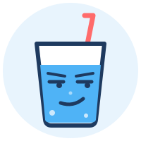

<p align="center"></p>

<h1 align="center">drink-with-me</h1>

<p align="center"><i>Your new drinking buddy. It only drinks water. It is disappointed in you.</i></p>

<p align="center">
  <a href="https://github.com/ArgonQQ/sipp/actions/workflows/ci.yml"></a>
  <a href="https://github.com/ArgonQQ/sipp/releases"></a>
  
  
  
  
</p>

You can ship 40 commits a day, but you can't finish one glass of water. This Claude Code mod sits above your
prompt and judges you about it. Quietly at first, then not.

**Costs zero tokens.** It never talks to the model, which is more restraint than you've shown with snacks.

## Install

In Claude Code:

```
/plugin install drink-with-me --marketplace ArgonQQ/sipp
```

Say `y` to add the marketplace, press Enter for the user scope. Done. That was harder than drinking water, wasn't it?

## Use

```
💧 ███░░░░░░░ 750/2000 ml · next glass in 42m [ +250 ml ]
I'm watching. Quietly. Judgingly.
```

- `[ +250 ml ]` logs a glass: click it, or `ctrl+x` `tab` then `d`.
- `[ Snooze 15m ]` appears when you're overdue (`s`). Procrastinate responsibly.
- `/drink 500` logs a custom amount; `/drink -250` undoes your lies.
- Ignore it and it toasts you every 15 min, getting ruder each time.

## Configure

`/config` → `drink-with-me`: daily goal, glass size, first/last reminder hour, OS notifications.

## Why 2 litres

Not vibes. Science, mostly:

- [EFSA (2010)](https://www.efsa.europa.eu/en/efsajournal/pub/1459): ~2.0 l/day total for women, ~2.5 l for men;
  ~20 % comes from food, so ~1.6 l / ~2.0 l from drinks.
- US National Academies (2004): 2.7 l / 3.7 l total, about 80 % from drinks.
- Kidneys clear roughly 0.8-1 l per hour, so small regular glasses beat one heroic chug.
- Reminders stop at 21:00 by default, so your bladder doesn't wake you at 3 a.m.

What's left of your goal is spread evenly over what's left of your day (never more often than every 20 min). Fall
behind and the gaps shrink. Actions, consequences.

More if it's hot, you exercise, or you're pregnant or breastfeeding. Heart or kidney condition? Ask a doctor, not a
sarcastic glass.
